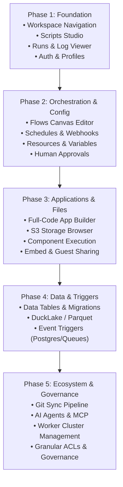

# Gantry Frontend: System Overview and Product Areas

Author: cleanroom agent
Date: 2026-11-02
Sources:
- `backend/windmill-api/openapi.yaml` (903 endpoints, 66 tags: scripts, flows, apps, jobs, resources, variables, schedules, triggers, datatables, ducklake, workers, workspaces, users, settings, audit, git sync)
- `openflow.openapi.yaml` (Flow orchestration specification, module structures, transforms, loops, branching, AI tools)
- `specs/not-implemented.md` (Gantry backend proprietary exclusion inventory, clean-room stand-ins, and stubs)
- Windmill Public Documentation (`https://windmill.dev/docs`):
  - Core Concepts (Scripts, Flows, Apps, Resources, Variables, Schedules, Triggers, Jobs, Workers, Workspaces)
  - Scripts Documentation (Multi-language runtimes, auto-generated parameter UIs, drafts, test runner, script locks, Hub sharing)
  - Flows Documentation (Visual flow builder, loops, conditional branching, error handlers, human-in-the-loop approvals and resume tokens, subflows)
  - Apps Documentation (Full-code React/Svelte raw app development, low-code component builder, component execution, S3 storage helpers, embed and guest sharing)
  - Triggers & Schedules (Cron schedules, HTTP/webhook endpoints, inbound email triggers, message queue consumers)
  - Resources & Variables (Resource types schema editor, secret storage, variable expiration handlers)
  - Data Tables & Storage (DuckLake/DuckDB workspaces, PostgreSQL data tables, migrations, data previews, S3 large file storage)
  - AI & Agents (AI prompt transforms, agent tools, Model Context Protocol (MCP) integrations, Slack bot agents, AI evals)
  - Observability & Operations (Job queue monitor, execution viewer, live logs, run metrics, service logs, audit logs)
  - Workspace Administration (Multi-workspace switching, folder hierarchies, granular ACLs, user roles, API tokens, Git Sync via GitHub App/git repos)
  - Instance & Global Settings (Server configuration, worker pools, concurrency groups, attached volumes, instance telemetry)
Attestation: I have not read Windmill's frontend source or proprietary code.

---

## 1. Introduction and Architectural Principles

Gantry is an open-source workflow and developer platform. The Gantry frontend is a completely clean-room single-page application (SPA) designed to interface with the Gantry backend solely through its documented public REST and Server-Sent Events (SSE) APIs.

### 1.1 Core Principles

1. **Clean-Room Integrity**: The user interface is specified and implemented independently. No code, structure, or assets are copied from upstream proprietary or frontend repositories. Layouts and user experiences are designed to satisfy user needs and API contracts cleanly and idiomatically.
2. **API-First Design**: Every UI interaction maps directly to endpoints defined in `backend/windmill-api/openapi.yaml` and flow representations in `openflow.openapi.yaml`.
3. **Workspace Isolation**: Workspaces are the primary multi-tenant boundary. Workspace-scoped routes follow `/w/{workspace}/...`, maintaining workspace context across navigation. Instance administration sits under `/admin/...` and `/settings`.
4. **Resilience to Backend Stubs**: Gantry's backend contains open-source stand-in modules (`*_oss.rs`) for features that upstream implements under proprietary licenses (documented in `specs/not-implemented.md`). The frontend must gracefully detect, indicate, and handle these boundaries (e.g., clear UI notices rather than uncaught errors when invoking stubbed email dispatch, external secret stores, or proprietary queue triggers).
5. **Real-Time Responsiveness**: Long-running jobs, flow execution states, and log outputs leverage backend SSE streams and targeted polling to provide instantaneous feedback.

---

## 2. Product Areas Map

The frontend is divided into twelve coherent functional domains:

| Area | Primary Tags | Key Capabilities |
| :--- | :--- | :--- |
| **1. Workspace & Navigation** | `workspace`, `folder`, `favorite`, `trash`, `path_autocomplete` | Workspace switcher, hierarchical folder explorer, global search, starred items, trash recovery. |
| **2. Scripts Studio** | `script`, `draft`, `helpers`, `npm_proxy`, `workspace_dependencies` | Multi-language code editor, auto-generated parameter UI, draft saving, test execution, version history. |
| **3. Flows Studio** | `flow`, `flow_conversations`, `input`, `openflow.openapi.yaml` | Canvas workflow builder, step dependencies, branch/loop constructs, human approvals, error handling. |
| **4. Apps Studio** | `app`, `raw_app`, `helpers` | Full-code (React/Svelte) and low-code app builder, component runner, S3 file viewer, public/embed sharing. |
| **5. Runs & Observability** | `job`, `service_logs`, `metrics`, `audit` | Real-time queue, execution viewer, log streaming, retry/cancel actions, service logs, performance metrics. |
| **6. Schedules & Triggers** | `schedule`, `trigger`, `http_trigger`, `*_trigger` | Cron schedules, webhook endpoints, email triggers, event-driven queue consumers (Postgres, Kafka, SQS, etc.). |
| **7. Resources & Variables** | `resource`, `variable` | Credential/connection manager, JSON schema type builder, plaintext/encrypted variables, expiration policies. |
| **8. Data Tables & Storage** | `workspace` (datatables/ducklake), `helpers` (s3/duckdb), `volume` | DuckLake/SQL table explorer, migration manager, S3 storage browser, Parquet/CSV file preview. |
| **9. AI & Agent Tools** | `ai`, `ai_evals`, `slack_agents`, `mcp`, `mcp_oauth` | AI agent definitions, prompt evaluations, Slack bot integrations, Model Context Protocol (MCP) tool server configs. |
| **10. Git Sync & Deployments** | `Git Sync`, `workspace` (deployments) | Git repository synchronization (scripts, flows, apps as code), environment promotion pipelines. |
| **11. Access & Governance** | `user`, `group`, `granular_acl`, `token`, `oauth`, `oidc` | User directory, group memberships, granular resource ACLs, API token management, SSO/OIDC configuration. |
| **12. Instance Administration** | `admin`, `setting`, `settings`, `config`, `worker`, `concurrencyGroups` | Global instance settings, worker cluster monitoring, concurrency limits, system health, telemetry. |

---

## 3. Detailed Product Area Specifications

### 3.1 Workspace & Navigation

#### Purpose
Enables users to navigate between workspaces, explore assets within a hierarchical folder tree, quickly search across all runnables, and manage deleted items.

#### User Capabilities
- **Workspace Switching**: View available workspaces (`GET /workspaces/list`), switch active workspace, inspect user's role per workspace (`GET /workspaces/users`).
- **Folder Hierarchy**: Browse, create, rename, and delete folders (`/w/{workspace}/folders/*`). Folders support ownership and default permission assignment (`FolderDefaultPermissionedAs`).
- **Asset Exploration & Search**: Full-text search and path auto-complete across scripts, flows, apps, resources, and variables (`GET /w/{workspace}/search`, `GET /w/{workspace}/path_autocomplete`).
- **Favorites & Starred**: Toggle favorite items for quick access on dashboard navigation (`/w/{workspace}/favorites/*`).
- **Trash Bin**: View soft-deleted runnables, restore assets, or permanently purge items (`/w/{workspace}/trash/*`).

#### Primary API Endpoints
- `GET /workspaces/list`: List all workspaces accessible to the user.
- `GET /w/{workspace}/folders/list`: List all folders in the workspace.
- `POST /w/{workspace}/folders/create`: Create a folder with optional permissions.
- `POST /w/{workspace}/folders/update/{name}`: Rename or reconfigure folder defaults.
- `DELETE /w/{workspace}/folders/delete/{name}`: Delete a folder.
- `GET /w/{workspace}/trash/list`: List deleted items.
- `POST /w/{workspace}/trash/restore`: Restore items from trash.

---

### 3.2 Scripts Studio (Code-First Runnables)

#### Purpose
A web-based IDE for developing, testing, versioning, and deploying standalone code functions in supported languages: Python, TypeScript, Go, Bash, SQL, Rust, PHP, etc.

#### User Capabilities
- **Multi-Language Code Editor**: Syntax highlighting, linting, error squiggles, and autocompletion for scripts.
- **Dynamic Parameter Schema Generation**: Scripts declare input parameters in code docstrings/type signatures. The backend parses these into JSON schemas (`ScriptArgs`). The UI dynamically renders typed input fields (strings, numbers, booleans, enums, JSON objects, resource references).
- **Drafts & Autosave**: Automatically persist unsaved edits per user to prevent loss (`/w/{workspace}/drafts/*`).
- **Live Test Runner**: Execute scripts in development mode (`POST /w/{workspace}/jobs/run_wait_result/p/{path}`), viewing real-time stdout/stderr, return values, execution duration, and memory utilization.
- **Dependency Management**: View and configure language package managers (e.g., Python PyPI packages, TypeScript `deno.json`/`npm` modules via `/npm_proxy/*`, workspace global dependencies).
- **Version Control & Diffing**: Inspect immutable version history (`/w/{workspace}/scripts/history/p/{path}`), view line diffs between versions, rollback, and manage script locks.
- **Hub Integration**: Browse public scripts from the Community Hub (`/scripts/hub/*`) and import or fork them into the workspace.

#### Primary API Endpoints
- `GET /w/{workspace}/scripts/get/p/{path}`: Retrieve script source, arguments, runtime, and metadata.
- `POST /w/{workspace}/scripts/create`: Create a new script.
- `POST /w/{workspace}/scripts/update/{path}`: Update script source and bump version.
- `DELETE /w/{workspace}/scripts/delete/{path}`: Delete or archive a script.
- `GET /w/{workspace}/scripts/history/p/{path}`: List revision history.
- `GET /w/{workspace}/drafts/get/*`, `POST /w/{workspace}/drafts/save`: Manage working drafts.
- `POST /w/{workspace}/jobs/run/p/{path}`: Trigger script execution.

---

### 3.3 Flows Studio (Visual Workflow Orchestration)

#### Purpose
A visual workflow builder enabling orchestration of scripts, subflows, conditional branches, loops, and human-in-the-loop steps into resilient end-to-end automation pipelines.

#### User Capabilities
- **Canvas / Linear Flow Designer**: Add, reorder, connect, and configure modules backed by `openflow.openapi.yaml` (`OpenFlow`, `FlowValue`, `FlowModule`).
- **Module Types**:
  - *Script Step (`PathScript`, `RawScript`)*: Reference an existing script or write inline script code.
  - *Subflow (`PathFlow`)*: Execute nested workflows.
  - *Branching (`BranchOne`, `BranchAll`)*: If/else conditional routes and parallel branch execution.
  - *Loops (`ForloopFlow`, `WhileloopFlow`)*: Iterate over arrays or evaluate loop predicates with concurrency controls.
  - *AI Steps (`AiAgent`, `AiDecision`)*: LLM-driven decision points and automated agent tasks.
  - *Identity / Pass-Through*: Transform intermediate states without external calls.
- **Input Transformation Editor**: Configure step inputs using static values (`StaticTransform`), JavaScript expressions (`JavascriptTransform`), or AI prompts (`AiTransform`).
- **Error & Retry Policies**: Configure per-step retry count, exponential backoff, stop-after conditions (`StopAfterIf`), and fallback error-handling steps.
- **Human-in-the-Loop & Flow Conversations**: Suspend execution awaiting approval or form inputs (`/w/{workspace}/flow_conversations/*`, `/w/{workspace}/inputs/*`). The UI provides an interactive inbox for operators to approve or provide missing values.
- **Flow Simulation & Debugger**: Test the flow step-by-step or run to completion with sample payloads.

#### Primary API Endpoints
- `GET /w/{workspace}/flows/get/{path}`: Fetch flow definition and metadata.
- `POST /w/{workspace}/flows/create`: Create a new flow.
- `POST /w/{workspace}/flows/update/{path}`: Update flow logic and increment revision.
- `DELETE /w/{workspace}/flows/delete/{path}`: Delete a flow.
- `POST /w/{workspace}/jobs/run/f/{path}`: Execute a flow.
- `GET /w/{workspace}/flow_conversations/list`: List open approvals and human-input requests.
- `POST /w/{workspace}/flow_conversations/resume`: Resume a suspended flow step.

---

### 3.4 Apps Studio (Full-Code and Low-Code Applications)

#### Purpose
Allows developers and internal teams to build interactive web applications and internal tools driven by Gantry scripts, flows, and data queries.

#### User Capabilities
- **Full-Code (Raw) Apps**:
  - Write standard React or Svelte frontends with full access to CSS, component libraries, and client dependencies.
  - Source bundles are uploaded and compiled on backend workers (`POST /w/{workspace}/apps/create_raw_source`, `POST /w/{workspace}/apps/update_raw_source/{path}`).
  - Live SDK preview token generation (`POST /w/{workspace}/apps/preview_sdk_token`) for responsive in-browser development.
- **Component Execution**: Execute backend scripts securely from app UI components (`POST /w/{workspace}/apps_u/execute_component/{path}`).
- **S3 & Data File Operations**: Direct file upload, download, and tabular previews (Parquet and CSV) within app widgets (`/w/{workspace}/apps_u/*`).
- **Public & Embedded Access**:
  - Configure custom public routes (`/apps_u/public_app_by_custom_path/{custom_path}`).
  - Control guest access and generate secure embed tokens (`/apps_u/embed_token_by_custom_path/*`).
  - Generate temporary presigned S3 URLs for anonymous data interaction (`POST /w/{workspace}/apps/sign_s3_objects`).

#### Primary API Endpoints
- `GET /w/{workspace}/apps/list`, `GET /w/{workspace}/raw_apps/list`: List apps in workspace.
- `GET /w/{workspace}/apps/get/p/{path}`: Fetch app configuration and asset bundles.
- `POST /w/{workspace}/apps/create`, `POST /w/{workspace}/apps/create_raw`: Create app.
- `POST /w/{workspace}/apps/update/{path}`, `POST /w/{workspace}/apps/update_raw/{path}`: Update app.
- `POST /w/{workspace}/apps/create_raw_source`: Compile full-code app from raw source.
- `POST /w/{workspace}/apps_u/execute_component/{path}`: Trigger backend runnable from app action.
- `GET /w/{workspace}/apps_u/load_parquet_preview/{path}`, `load_csv_preview/{path}`: Preview data files.

---

### 3.5 Runs & Observability (Jobs Engine)

#### Purpose
Provides real-time visibility and management of all background and on-demand script and flow executions across the workspace.

#### User Capabilities
- **Job Queue Monitor**: Track jobs in real time categorized by status: `queued`, `running`, `completed`, `canceled`, and `failed`.
- **Execution Details Viewer**:
  - Live log viewer streaming standard output and standard error.
  - Step-by-step progress tracking for flow executions (`FlowStatus`, `FlowStatusModule`).
  - Inspection of input arguments, environment metadata, return values, and stack traces.
- **Job Control**: Cancel running jobs (`POST /w/{workspace}/jobs_u/queue/cancel/{id}`), restart failed executions, or force execution with altered parameters.
- **Search & Filtering**: Filter job history by tag, path, status, triggering identity, date range, or duration (`GET /w/{workspace}/jobs/list`).
- **Audit & Diagnostics**: Inspect system service log files (`/service_logs/*`) and audit records (`/w/{workspace}/audit/*`).

#### Backend Status Note
As documented in `specs/not-implemented.md`, upstream's full-text log indexer (`windmill-indexer`) and long-term service log indexing are proprietary. In Gantry, log access operates directly on raw host log files and real-time database job records. Audit log persistence to external S3 storage is supported via OSS routes, while enterprise search filters are clean-room work.

#### Primary API Endpoints
- `GET /w/{workspace}/jobs/get/{id}`: Retrieve detailed job execution state and results.
- `GET /w/{workspace}/jobs/list`: List and filter workspace jobs.
- `POST /w/{workspace}/jobs_u/queue/cancel/{id}`: Cancel a running or queued job.
- `GET /w/{workspace}/jobs/get_logs/{id}`: Retrieve execution logs.
- `GET /service_logs/list_files`, `GET /service_logs/get_log_file/{path}`: Access host service logs.
- `GET /w/{workspace}/audit/list`: List workspace audit events.

---

### 3.6 Schedules & Triggers

#### Purpose
Enables automated, unattended execution of scripts and flows triggered by time-based schedules, HTTP webhooks, emails, or asynchronous message bus events.

#### User Capabilities
- **Cron Schedules**:
  - Configure cron expressions with human-readable schedule previews (`POST /schedules/preview`).
  - Associate schedules with specific target runnables, timezone overrides, default arguments, and enabled toggles (`/w/{workspace}/schedules/*`).
- **HTTP & Webhook Triggers**:
  - Expose unique HTTP endpoints that trigger scripts or flows upon receipt of incoming HTTP requests (`/w/{workspace}/http_triggers/*`).
  - Configure authentication headers, secret tokens, and route parameters.
- **Event-Driven Triggers**:
  - Configure native triggers and database event hooks (e.g., PostgreSQL `LISTEN`/`NOTIFY` via `/w/{workspace}/postgres_triggers/*`).
  - Configure message broker triggers (AMQP, MQTT, WebSockets).

#### Backend Status Note
As noted in `specs/not-implemented.md`, inbound email triggers (`email_trigger`) and certain proprietary event queues (Kafka, NATS, AWS SQS, GCP Pub/Sub, Azure Service Bus) are currently stand-ins or refusals in Gantry. The UI should display configuration options for supported open-source triggers while cleanly disabling or marking proprietary triggers as pending clean-room implementation.

#### Primary API Endpoints
- `GET /w/{workspace}/schedules/list`: List all workspace schedules.
- `POST /schedules/preview`: Preview human-readable schedule and next execution times.
- `POST /w/{workspace}/schedules/create`: Create schedule.
- `POST /w/{workspace}/schedules/setenabled/{path}`: Enable or disable schedule.
- `DELETE /w/{workspace}/schedules/delete/{path}`: Remove schedule.
- `GET /w/{workspace}/http_triggers/list`: List webhook triggers.
- `POST /w/{workspace}/http_triggers/create`: Create webhook trigger.
- `GET /w/{workspace}/postgres_triggers/list`: List PostgreSQL listener triggers.

---

### 3.7 Resources & Variables (Configuration & Secrets)

#### Purpose
Manages shared infrastructure configurations, third-party API credentials, connection strings, and encrypted variables utilized across scripts, flows, and apps.

#### User Capabilities
- **Resource Types (Schema Management)**:
  - Define and inspect JSON Schemas representing distinct connection types (e.g., `postgresql`, `s3`, `slack`, `github`, `smtp`).
  - View required fields, data types, and default property structures (`ResourceType`).
- **Resource Instances**:
  - Create and manage instantiated credentials complying with their respective `ResourceType` schema.
  - Set granular read/write permissions per resource.
- **Variables Management**:
  - Key-value repository for shared constants, configurations, and secrets.
  - Distinct handling for plaintext vs. encrypted variables (`/w/{workspace}/variables/encrypt`).
  - Variable expiration policies and automated cleanup handlers (`VariableExpirationHandlerConfig`).

#### Backend Status Note
As noted in `specs/not-implemented.md`, external secret vaults (HashiCorp Vault, AWS Secrets Manager, Azure Key Vault) are proprietary upstream features. Gantry securely stores encrypted secrets in its PostgreSQL database using database encryption keys.

#### Primary API Endpoints
- `GET /w/{workspace}/resources/type/list`: List available resource schemas.
- `GET /w/{workspace}/resources/list`: List resource instances.
- `POST /w/{workspace}/resources/create`: Instantiate a new resource.
- `POST /w/{workspace}/resources/update_value/{path}`: Update resource values.
- `DELETE /w/{workspace}/resources/delete/{path}`: Delete a resource.
- `GET /w/{workspace}/variables/list`: List workspace variables.
- `POST /w/{workspace}/variables/create`: Create variable (plaintext or secret).
- `POST /w/{workspace}/variables/encrypt`: Encrypt sensitive variable values.

---

### 3.8 Data Tables & Workspace Storage

#### Purpose
Provides built-in relational SQL storage and analytical data management (DuckDB / DuckLake / PostgreSQL) directly accessible by scripts, flows, and apps within the workspace.

#### User Capabilities
- **Data Table Exploration**:
  - Browse workspace SQL tables, column definitions, data types, and indices (`/w/{workspace}/workspaces/list_datatables`, `list_datatable_tables`).
  - Test database connectivity and inspect table schemas (`test_datatable_connection`, `get_datatable_table_schema`).
- **Database Migrations**:
  - Track, create, apply, and rollback table migrations (`create_datatable_migration`, `run_datatable_migrations`, `rollback_datatable_migrations`).
  - Generate initial migration files from existing database states.
- **DuckLake / DuckDB Analytical Storage**:
  - Browse DuckLake namespaces and Parquet object stores.
  - View storage consumption statistics (`GET /settings/object_storage_usage`).
- **File & Object Storage Browser**:
  - Upload, download, move, and preview large files stored in workspace S3-compatible storage (`/w/{workspace}/job_helpers/upload_s3_file`, `download_s3_file`, `load_parquet_preview`).

#### Primary API Endpoints
- `GET /w/{workspace}/workspaces/list_datatables`: List relational data tables.
- `GET /w/{workspace}/workspaces/list_datatable_tables`: List tables in a database.
- `POST /w/{workspace}/workspaces/run_datatable_migrations/{name}`: Run schema migrations.
- `GET /w/{workspace}/workspaces/list_ducklakes`: List DuckLake namespaces.
- `POST /w/{workspace}/job_helpers/duckdb_connection_settings`: Retrieve DuckDB configuration.
- `GET /w/{workspace}/job_helpers/download_s3_parquet_file_as_csv`: Convert and download Parquet files as CSV.

---

### 3.9 AI & Agent Tools

#### Purpose
Enables construction and execution of autonomous AI agents, evaluation of model outputs, Slack bot workflows, and integration with the Model Context Protocol (MCP).

#### User Capabilities
- **Model Context Protocol (MCP)**:
  - Expose workspace scripts and flows as standardized MCP tools (`GET /mcp/w/{workspace}/list_tools`) for external AI clients (Claude Desktop, cursor, LLM agents).
  - Manage OAuth authorizations for MCP clients (`/mcp_oauth/*`).
- **AI Transformations & Agent Steps**:
  - Configure AI steps within flows that use prompt engineering, provider configuration (OpenAI, Anthropic, local models), and tool-calling capabilities (`AiAgent`, `AgentTool`).
- **AI Evaluations (Evals)**:
  - Create and manage automated evaluation suites to benchmark LLM outputs against test criteria (`/w/{workspace}/ai_evals/*`).
- **Slack Agent Workflows**:
  - Deploy interactive conversational Slack bots backed by Gantry scripts and flows (`/slack_agents/*`, `/oauth/connect_slack_*`).

#### Primary API Endpoints
- `GET /mcp/w/{workspace}/list_tools`: Expose workspace runnables as MCP tools.
- `GET /w/{workspace}/ai_evals/list`: List AI evaluation benchmarks.
- `POST /w/{workspace}/ai_evals/create`: Create an AI evaluation suite.
- `GET /slack_agents/list`: List configured Slack agents.
- `POST /oauth/connect_slack_instance`: Authorize Slack app integration.

---

### 3.10 Git Sync & Deployments

#### Purpose
Facilitates GitOps workflows by synchronizing workspace assets with Git repositories and managing multi-environment promotion (Development -> Staging -> Production).

#### User Capabilities
- **Git Repository Synchronization**:
  - Connect Git repositories (via GitHub App or generic Git credentials) to synchronize workspace scripts, flows, and apps to/from repository directories (`/w/{workspace}/github_app/*`).
  - Review incoming changes, trigger manual import/export, and inspect commit history.
- **Environment Promotion**:
  - Promote verified scripts and flows across workspace stages.
  - Review code diffs and dependency updates before applying promotions.

#### Backend Status Note
As documented in `specs/not-implemented.md`, multi-repository automated sync and formal enterprise deployment requests are currently stubbed in Gantry. Single repository bidirectional sync via GitHub App or Git integration is supported via open-source endpoints.

#### Primary API Endpoints
- `GET /github_app/connected_repositories`: List connected GitHub repositories.
- `POST /w/{workspace}/github_app/install_from_workspace`: Link repository to workspace.
- `GET /w/{workspace}/github_app/export/{installationId}`: Export workspace assets to Git.
- `POST /w/{workspace}/github_app/import`: Import assets from Git into workspace.

---

### 3.11 Access, Governance & Workspace Administration

#### Purpose
Governs user identities, workspace memberships, permission boundaries, and API credentials.

#### User Capabilities
- **Workspace Membership & Roles**:
  - Invite users, edit member roles (Admin, Member, Viewer, Operator), and remove members (`/w/{workspace}/users/*`).
- **Workspace Groups**:
  - Create functional groups (e.g., Engineering, Operations) and bind them to permission scopes (`/w/{workspace}/groups/*`).
- **Granular Access Control Lists (ACLs)**:
  - Define fine-grained read, write, and execute permissions on individual scripts, folders, resources, and variables (`/w/{workspace}/granular_acl/*`).
- **API Tokens**:
  - Generate, inspect, and revoke workspace API tokens with scoped permission sets (`/tokens/list/scopes`).
- **OAuth & Identity Connections**:
  - Connect third-party OAuth providers for user authentication and script integrations (`/w/{workspace}/oauth/*`).

#### Backend Status Note
Per `specs/not-implemented.md`, user creation, password resets, and invite emails currently operate on backend stand-ins (`users_oss.rs`, `email_oss.rs`). SSO via enterprise SAML/SCIM is proprietary upstream and stubbed in Gantry. The UI will initially interact with seeded admin users and standard API tokens until clean-room user management is completed.

#### Primary API Endpoints
- `GET /w/{workspace}/users/list`: List workspace members.
- `POST /w/{workspace}/users/add`: Add member to workspace.
- `POST /w/{workspace}/users/edit_role`: Update member role.
- `GET /w/{workspace}/groups/list`: List workspace groups.
- `POST /w/{workspace}/granular_acl/add`: Assign granular permissions to asset path.
- `GET /tokens/list/scopes`: List authorized token scopes.

---

### 3.12 Instance & Global Administration

#### Purpose
Empowers instance administrators to configure global server parameters, monitor distributed worker clusters, enforce concurrency limits, and supervise platform health.

#### User Capabilities
- **Worker Pool Oversight**:
  - Monitor registered worker nodes, ping latency, system resource consumption (CPU/RAM), active job counts, and worker tags (`/workers/*`, `/w/{workspace}/workers/*`).
- **Concurrency Groups**:
  - Configure named concurrency queues to throttle parallel executions across sensitive third-party services or databases (`/w/{workspace}/concurrencyGroups/*`).
- **Volume Management**:
  - Monitor and configure persistent storage volumes attached to workers (`/w/{workspace}/volumes/*`).
- **Global Settings & Configuration**:
  - View and adjust instance-wide configuration flags, default timeouts, and security policies (`/settings/*`, `/configs/*`).
- **System Health & Diagnostics**:
  - Check instance health status, detailed subsystem diagnostics, and database connection pools (`GET /health/status`, `GET /health/detailed`).

#### Primary API Endpoints
- `GET /health/status`, `GET /health/detailed`: Instance health checks.
- `GET /workers/custom_tags`, `GET /configs/list_worker_groups`: List worker configurations.
- `GET /concurrency_groups/list`: List concurrency limits.
- `POST /w/{workspace}/concurrencyGroups/create`: Create concurrency group.
- `GET /w/{workspace}/volumes/list`: List worker volumes.
- `GET /configs/list`: List server configuration parameters.
- `GET /settings/object_storage_usage`: Inspect global storage metrics.

---

## 4. Cross-Cutting UI Architecture

### 4.1 URL Routing Structure

The frontend URL hierarchy mirrors the separation of multi-tenant workspace assets from global administration:

```text
/                              -> Redirect to default workspace or workspace selection
/login                         -> User authentication
/workspaces                    -> Workspace directory and creation

/w/:workspace/
  ├── dashboard                -> Workspace overview, recent runs, starred assets
  ├── scripts/
  │     ├── p/*path            -> Script editor, parameter UI, history
  │     └── new                -> Create new script
  ├── flows/
  │     ├── p/*path            -> Flow canvas editor, step configuration
  │     └── new                -> Create new flow
  ├── apps/
  │     ├── p/*path            -> App builder / raw app editor
  │     └── new                -> Create new app
  ├── runs/
  │     ├── :job_id            -> Execution log viewer, flow visualizer
  │     └── (list)             -> Real-time job queue and historical search
  ├── schedules/               -> Cron schedule manager
  ├── triggers/                -> Webhook and event trigger registry
  ├── resources/               -> Connection and credential manager
  ├── variables/               -> Plaintext and encrypted variables
  ├── datatables/              -> Relational tables, DuckLake explorer, migrations
  ├── storage/                 -> S3 file browser and previews
  ├── git/                     -> Git sync and repository settings
  └── settings/                -> Workspace members, groups, granular ACLs

/admin/
  ├── health                   -> System health and diagnostics
  ├── workers                  -> Worker cluster nodes and tags
  ├── concurrency              -> Concurrency groups
  ├── volumes                  -> Persistent storage volumes
  └── settings                 -> Global instance parameters
```

### 4.2 State Management & Real-Time Data

1. **Server State Caching**: REST endpoints are queried with automatic deduplication, caching, and invalidation upon mutations.
2. **Streaming Execution Feeds**: Active job logs and flow progress leverage Server-Sent Events (SSE) where available, falling back to exponential backoff polling during high-throughput execution.
3. **Draft State Persistence**: Unsaved editor changes for scripts and flows automatically sync with the `/drafts/*` backend endpoints to guarantee zero data loss across browser reloads or disconnects.

### 4.3 Handling Backend Stubs Gracefully

Because Gantry replaces upstream proprietary modules with open-source stubs (`*_oss.rs`), the frontend adheres to strict guidelines for stubbed capabilities:
- **Informative Badges**: Features backed by stubs (e.g., SMTP email notifications, external secret vaults, proprietary queue triggers) are accompanied by a non-intrusive badge: `Not yet implemented in Gantry (Clean-room)`.
- **Actionable Guidance**: When attempting an action that returns a standard Gantry refusal (`501 Not Implemented` or `"not supported in Gantry"`), the UI displays a clear explanation linking to documentation rather than an unhandled error modal.
- **Fail-Safe UI Defaults**: Forms for stubbed features provide mock/local alternatives where available (e.g., database secret storage instead of external vaults).

---

## 5. Specification Roadmap and Phasing

Development of detailed specifications and frontend implementations proceeds in five sequential phases:



1. **Phase 1: Foundation & Core Runnables**
   - Workspace shell, folder tree navigation, search, and trash.
   - Script editor, parameter form generator, live test runner, drafts.
   - Job queue, execution detail viewer, log streaming.
2. **Phase 2: Orchestration & Configuration**
   - Flow canvas editor, step dependency wiring, branch/loop modules.
   - Cron schedule management and preview.
   - Resource type schema editor, credentials manager, encrypted variables.
   - Human-in-the-loop approval inbox.
3. **Phase 3: Applications & User Interfaces**
   - Raw full-code app editor (React/Svelte worker compilation), live preview.
   - Component runner and backend script binding.
   - S3 large file storage browser, Parquet/CSV preview components.
   - Public sharing, guest entry, and embed token workflows.
4. **Phase 4: Data Tables & Event Triggers**
   - Workspace SQL table explorer, DuckLake browser, migration execution.
   - Webhook triggers, PostgreSQL listener triggers, event message consumers.
5. **Phase 5: Advanced Ecosystem & Governance**
   - Git Sync repository setup, export, and import pipelines.
   - AI agent editor, prompt evals, MCP server tool discovery.
   - Worker pool oversight, concurrency throttling, worker volumes.
   - Granular ACLs, group permissions, and instance settings.
